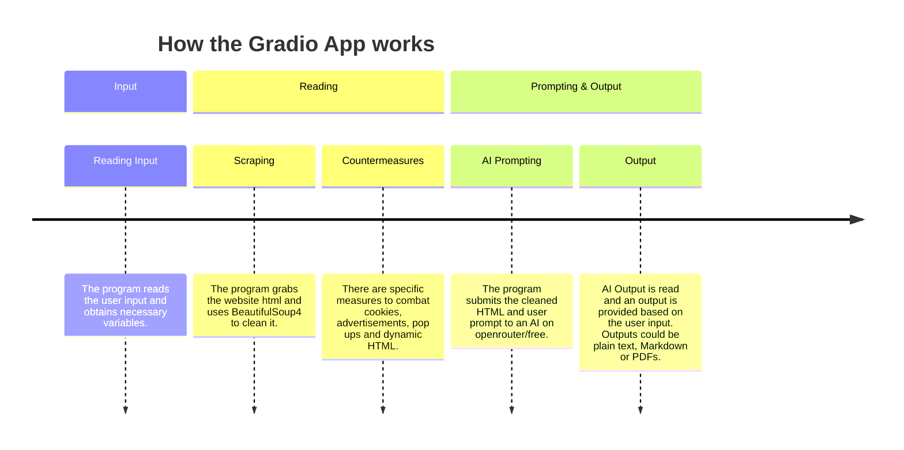

[**Overview**](README.md) &nbsp;&nbsp;|&nbsp;&nbsp; [Prerequisites](PREREQUISITES.md)

  
  
   A personal projects repository 
  
         
  
   Made with Gemini and Cursor 

## Introduction
This is my personal collection of projecats made using Python(3.11) and Jupyter Notebook, with the help of Gemini and Cursor. Prerequisites are listed [here](PREREQUISITES.md).

**The projects focus mainly on these attributes:**
- Web Scraping
- Automation
- Sorting
- AI

### List of Content

| Project | Function |
| ------- | ------- |
|  |  app that processes a website from an url, then uses an AI (free model) to extract information based on user request.|
|  |  app that automatically plays cookie clicker. |
|  | App that automates whatsapp messages by sending a message + image(optional) to a large group of recipents listed in a CSV file. |
|  | Web scraping Demonstration. Uses  to navigate through HKTV Mall website's dynamnic HTML, then analyses it using .| 
|  | A small collection of programs that perform sorts of numbered item lists in different methods. |
|  | A Demonstration that uses  to scrape the pdf, then sort D1 Question and Answer Papers together by topic by locating specific keywords. |

## Gradio App

The gradio app is a web-based application that works natively on the user's computer. Here's a short demonstration:

placeholder_gradio.gif

The app works in a linear direction:

For this app to work, you must have an [OpenRouter](https://openrouter.ai) key. You can use one with 0 tokens as this uses a free model. 

Try it out in your computer!

## Cookie Cooker

Cookie Cooker plays [Cookie Clicker](https://cookie-clicker2.com/) in Chrome. It clicks the big cookie and buys Cursor, Grandma, Farm, and Mine when they are affordable.

Here's a short demo:
cookieplaceholder.gif

Try it out in your computer!

## Whatsapp Bot

Whatsapp Bot automates large-scale whatsapp messages for companies and advertisements. It works by scraping the HTML using BeautifulSoup4, then traces whatsapp html using Selenium to locate elements to input images and text, and to send the message.

Here's a short demo of it in action:
whatsappplaceholder.gif

## HKTV Mall scraper

`HKTV Mall Web Scraping Demonstration` scrapes beef steak search results from HKTV Mall, and combats dynamic HTML by scrolling to the bottom then scraping.

Then, the statistics are scraped and the characteristics, such as origin of Product, sale quantity, overall rating of the product are found using Selenium locators, then grouped using pandas.

Characteristics of the data set, such as most common origin of product, products with the highest sales, etc, are analysed.

You can also try using other keywords in the notebook to experiment.

Note that the current figure may differ from the one pre-loaded in the notebook. 

## Sorting algorithms

`Sorting Algorithms` has three programs that read numbers until you type `end`, then sort them:

| Program | Method |
| --- | --- |
| `bubble_sort.py` | Compare neighbours and move the smaller one forward |
| `bogo_sort.py` | Shuffle until the list happens to be sorted |
| `random_quick_sort.py` | Pick a random pivot and sort the two sides |

## IAL D1 papers

`IAL D1 Papers` sorts Edexcel International A Level Decision Mathematics 1 past papers by topic. The source papers are in `Past Papers`. `D1management.ipynb` files each question into one pack and rebuilds the PDFs in `D1_Sorted_Final`:

- Algorithms
- Critical Path Analysis
- Graph I
- Graph II
- Linear Programming

The sorted by-topic PDFs are available to view in `D1_Sorted_Final`.
