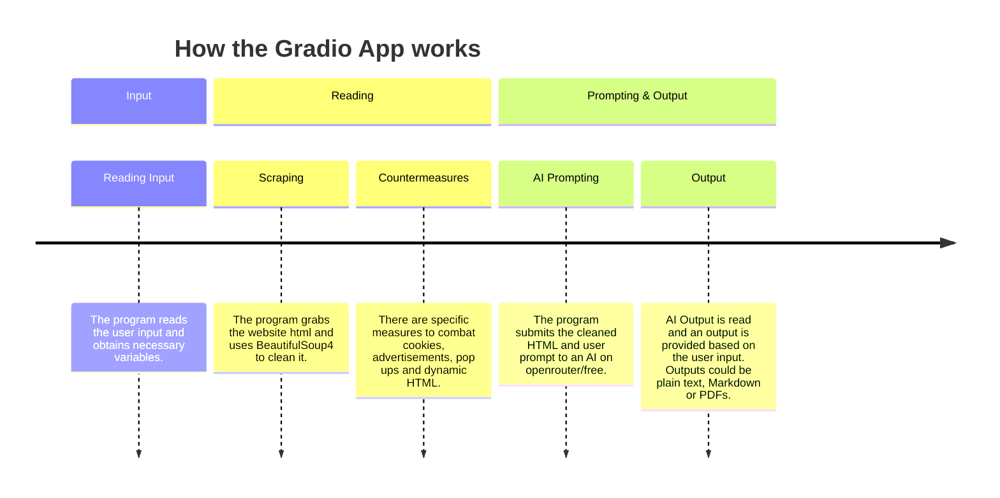

[**Overview**](README.md) &nbsp;&nbsp;|&nbsp;&nbsp; [Install](INSTALL.md)

  
  
   A personal projects repository 
  
        
  
   Made with Gemini and Cursor 

## Introduction
This is my personal collection of projects. The packages for all of them are in [requirements.txt](requirements.txt). Install steps are [here](INSTALL.md).

**The projects focus mainly on these attributes:**
- Web Scraping
- Automation
- Sorting
- AI

### List of Content

| Project | Function |
| ------- | ------- |
|  |  app that processes a website from an url, then uses an AI (free model) to extract information based on user request.|
|  |  app that automatically plays cookie clicker. |
|  |  app that automates whatsapp messages by sending a message + image(optional) to a large group of recipients listed in a CSV file. |
|  | Web scraping Demonstration. Uses  to navigate through HKTV Mall website's dynamnic HTML, then analyses it using  and visualised using . | 
|  | A small collection of programs that perform sorts of numbered item lists in different methods. |
|  | A Demonstration that uses  to scrape the pdf, then sort D1 Question and Answer Papers together by topic by locating specific keywords. |

## Gradio App

The gradio app is the most ambitious project in this repository. I made this app to provide a clearer interface so that users can get better outputs from AI without having to purchase a subscription.

It is a multi-purpose, web-based application that works natively on the user's computer. 

Here's an example output:

[News summary.pdf](https://github.com/user-attachments/files/34429324/News.summary.pdf)

The app works in a linear direction:

For this app to work, you must have an [OpenRouter](https://openrouter.ai) key. You can use one with 0 tokens as this uses a free model. 

### Navigation

Thanks to Gradio, a simple input/output interface was achieved. There are 2 main sections of input:
- Prompt
- Output format

The prompt box features several adjustable elements and the input HTML, and the output box decides the format of the output:

This layout aims to minimize confusion and allow for a flexible range of both inputs and outputs.

Try it out on your computer!

## Cookie Cooker

Cookie Cooker is a fun project that plays [Cookie Clicker](https://cookie-clicker2.com/) in Chrome. It clicks the big cookie and buys Cursor, Grandma, Farm, and Mine when they are affordable.

Here's a short demo:

Try it out on your computer!

## Whatsapp Bot

Whatsapp Bot automates large-scale whatsapp messages for companies and advertisements. It works by scraping the HTML using BeautifulSoup4, then traces whatsapp html using Selenium to locate elements to input images and text, and to send the message.

There are 2 versions of the app:
- Standard (text + image option, to many recipients)
- Spammer (just text, to one single recipient)

The standard is designed for companies to do advertisements to a large group of people, while the spammer is just for demonstrative purposes only.
  
Here is a quick demo of how it sends messages (Cell 3):

In the standard version, the app can jump from recipient to recipient:

Note that the names can also change from recipient to recipient. Do not use spammer to harass someone.

## HKTV Mall scraper

`HKTV Mall Web Scraping Demonstration` scrapes beef steak search results from HKTV Mall, and combats dynamic HTML by scrolling to the bottom then scraping.

Then, the statistics are scraped and the characteristics, such as origin of Product, sale quantity, overall rating of the product are found using Selenium locators, then grouped using pandas.

Characteristics of the data set, such as most common origin of product, products with the highest sales, etc, are analysed.

This is one of the Dataframes extracted by pandas:

Using the Dataframe from pandas, the data can be easily visualised using Matplotlib.

Here is a pie chart showing origin of the products, plotted using Matplotlib:

By using a criteria model, a top 10 recommendation list can be obtained (this as of 8/11/2026):

Note that the current figure may differ from the one pre-loaded in the notebook. 

## Sorting algorithms

`Sorting Algorithms` was made as a learning project. It has three programs that read numbers until you type `end`, then sort them:

| Program | Method |
| --- | --- |
| `bubble_sort.py` | Compare neighbours and move the smaller one forward |
| `bogo_sort.py` | Shuffle until the list happens to be sorted |
| `random_quick_sort.py` | Pick a random pivot and sort the two sides |

## IAL D1 papers

`IAL D1 Papers` sorts Edexcel International A Level Decision Mathematics 1 past papers by topic. The source papers are in `Past Papers`. `D1management.ipynb` files each question into one pack and rebuilds the PDFs in `D1_Sorted_Final`:

- Algorithms
- Critical Path Analysis
- Graph I
- Graph II
- Linear Programming

The sorted by-topic PDFs are available to view in `D1_Sorted_Final`.
